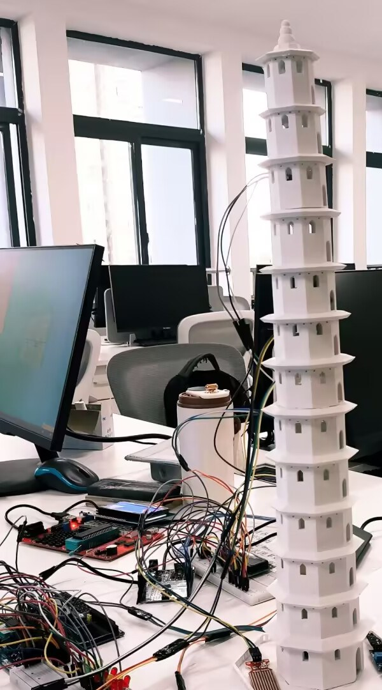
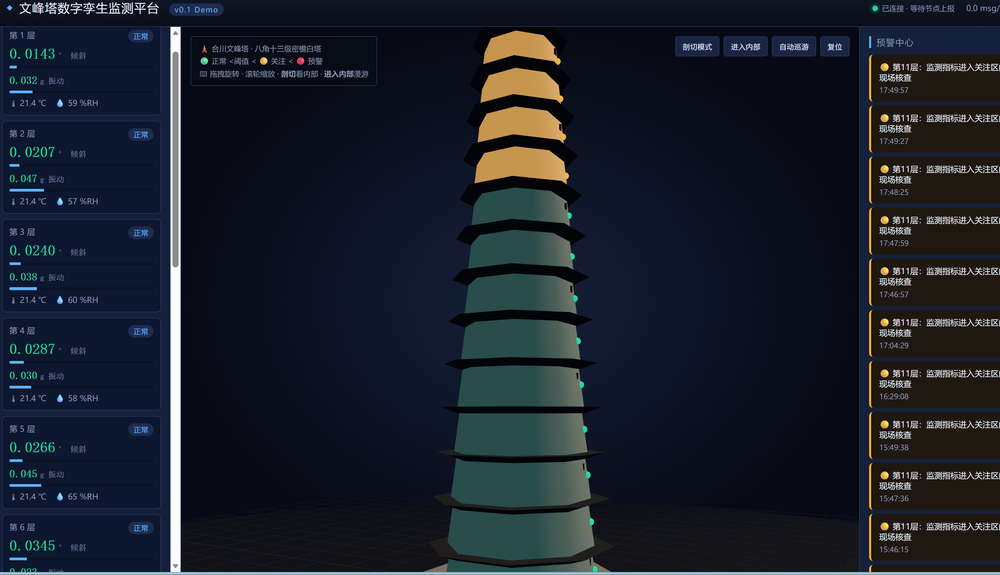
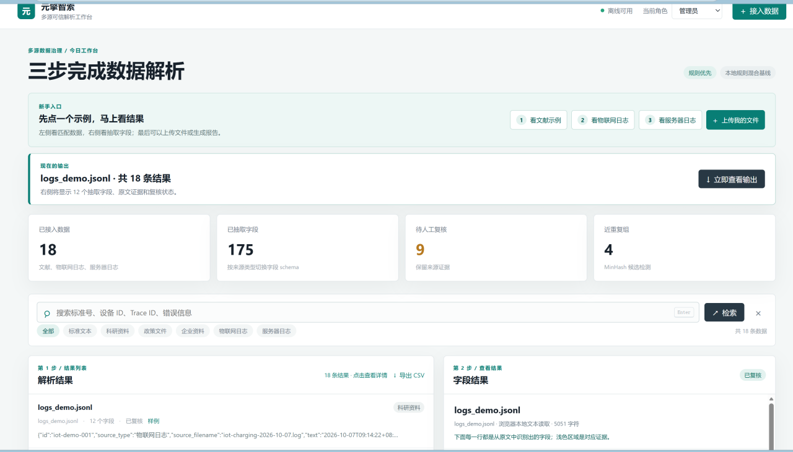

# DDC2026 作品集

> 2026 地瓜机器人黑客松报名材料。三个项目，一条主线：**把现场数据采回来 → 让人看得懂 → 让机器自己判断**。

| # | 项目 | 时间 | 我的角色 | 状态 |
|---|---|---|---|---|
| 1 | 云守文峰 · 古塔结构监测 | 2026.04 – 至今 | 技术文档 / 现场数据采集 / 检测平台 | 已参赛，持续迭代 |
| 2 | 元擎智索 · 多源异构数据解析工作台 | 2026.08 – 09 | 团队协作 | 可运行交付 |
| 3 | 极瞳判官 · 视界通 | 2026 | 方案设计 | 方案阶段，未编码 |

---

## 1. 云守文峰 · 古塔结构监测装置

**场景**　重庆合川文峰塔（清代砖石古塔，市级文物保护单位）。既有亮化工程采用打孔固定，已对塔体造成不可逆损伤——这决定了方案的第一约束是「零侵入」，而不是「提高巡检效率」。

**做了什么**　一套面向砖石古塔的预防性保护装置：以缩比塔模作为非侵入载体承载感知单元，覆盖水患、火情、结构震动与微环境四类风险，本地声光告警，并配套浏览器端可视化监测界面，用于远程查看与分级预警。

**技术方向**　物联网感知 · 嵌入式采集 · MQTT · 浏览器端三维可视化

**我负责**　技术文档撰写、现场拍照与数据采集、后期检测平台（前端可视化）。硬件装置由团队其他成员完成。

**成果**　中国大学生计算机设计大赛 · 物联网应用 / 城市管理赛道，校赛二等奖。

**状态与边界**　可视化界面可本地运行；三维模型为程序化生成，非摄影级精度；无节点接入时以模拟数据演示。参赛技术文档中的组网与云平台部分属于架构规划，尚未全部落地。

---

## 2. 元擎智索 · 多源异构数据解析工作台

**场景**　同一批技术资料里，标准文献是条款式、政策文件是段落式、物联网日志与服务器日志又是半结构化文本。人工抽字段费时，直接丢给大模型则是黑盒输出——**结论对不对、依据在原文哪一句，无法复核**。

**做了什么**　一套离线单页应用，把四类来源统一解析为结构化字段，**每个字段都带字符级原文坐标**（UTF-16 start/end），点字段即跳回原文对应字符，而不是黑盒给值。全程留痕、支持人工复核与 CSV 导出。双击即运行，零依赖、不联网也能跑。

**技术方向**　离线单页应用 · 可解释规则引擎 · 字段级溯源 · MinHash 近重复检测 · 双套 schema 自动切换

**能力**　8 种文本格式导入；文献 12 类 / 日志 12 类双 schema 自动切换。文献侧含标准编号、发布日期、技术领域、适用范围、技术指标、测试条件、引用标准等；日志侧含事件时间、日志级别、设备 ID、Trace ID、状态码等。

**评测口径（严格）**　1500 条程序合成语料（seed 20261007，6 个来源组，18000 个实体）。**按来源组整体隔离**：3 组只进训练、1 组只进验证、2 组只进测试——测试集 500 条里的来源在训练阶段从未出现，跨划分泄漏由评测脚本单独校验。实体级精确匹配：**测试集 micro-F1 89.00%**（P 98.84% / R 80.95%），验证集 89.59%（250 条）。

**当前实现**　跑的是可解释规则基线，服务端 `/api/health` 如实返回 `model: rule-baseline`；RoBERTa-BiLSTM-CRF 接口已预留，可替换，异常时自动回退到规则。**上述 89% 是规则基线的成绩，不是模型成绩。**

**边界**　① 语料为程序合成，非真实机构记录，89% 不等同真实业务场景表现；② 召回 80.95% 明显低于精确率 98.84%，是规则"宁漏不误"的取舍结果；③ 另有 40 条真实文献人工试标数据，量级不足，不作为指标依据。

**我负责**　数据集构建与标注校验（Label Studio，1500 条）、留出集测试与指标核验；字段 schema 与解析规则由团队共同确定。

---

## 3. 极瞳判官 · 视界通

**做了什么**　面向交通事故场景的视觉识别与责任判定方案设计，完成产品构成、多模态感知配置与判定流程设计。

**状态**　方案阶段，未进入代码实现，不作为已交付成果。

---

## 关于这次黑客松

v1 把数据采回来，v2 让人看得懂，下一步想让机器自己判断。48 小时里我倾向于做一个现场能验证的最小闭环，而不是再叠一层可视化。

---

## 说明

本仓库仅用于 DDC2026 报名评审查看，包含项目介绍与界面截图。完整源码、技术文档与数据集不在此公开，如需查阅请联系作者。
